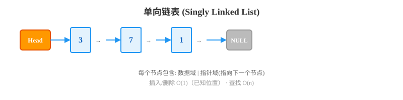
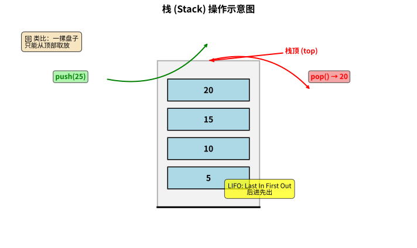
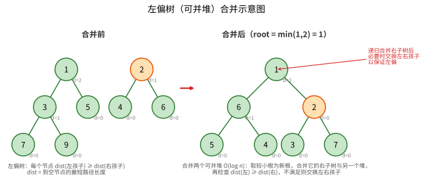
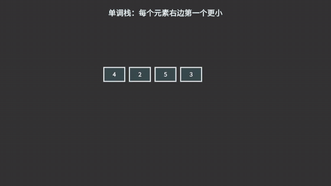
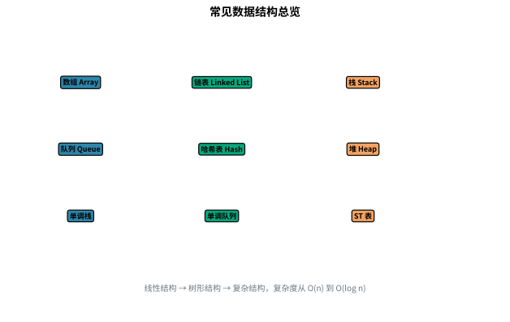

# 第 2 章：基础数据结构

> **学习目标**：掌握数组、链表、栈、队列、哈希表、堆、单调栈/队列与 ST 表的原理、实现和复杂度。
>
> **先修知识**：第 1 章复杂度分析；0B 的 Python 语法。


> 程序 = 数据结构 + 算法。数据结构是算法的基石，选对数据结构，问题就解决了一半。

---

数据结构是计算机**存储、组织数据的方式**，而算法是**操作数据的具体步骤**。二者相辅相成：

> 💡 **类比：数据结构如同"厨房收纳术"**
>
> 想象你是一位厨师，厨房里堆满了各种食材和工具。**数据结构就是你整理厨房的方式**：
> - **数组**：像一排整齐的量杯——按大小排列，伸手就能拿到想要的那个（随机访问快），但要在中间塞一个新杯子就得把所有杯子挪一遍（插入慢）
> - **链表**：像一条寻宝线索链——每个纸条写着"下一个线索在抽屉里"，找东西要顺藤摸瓜（顺序访问），但加新线索只需改一张纸条（插入快）
> - **栈**：像一摞盘子——只能从最上面拿和放（后进先出）
> - **队列**：像银行排队叫号——先来先服务（先进先出）
> - **哈希表**：像字典的目录——查一个字不用翻遍整本字典，直接按拼音定位（O(1) 查找）
> - **堆**：像公司的组织架构——老板永远在最上面，每次提拔都从最合适的候选人中选拔（优先队列）
>
> **选对数据结构，就像选对收纳方式**——厨房整理好了，做菜效率自然高。

- **数据结构为算法提供载体**——算法需要依赖数据结构来存取和操作数据
- **算法驱动数据结构运转**——数据结构的各项操作（插入、删除、查找等）本身就是算法
- **选择合适的数据结构，可以让算法更高效**——例如用哈希表将查找从 O(n) 降到 O(1)

> 正如计算机科学家 Niklaus Wirth 的经典著作《Algorithms + Data Structures = Programs》所总结的：**程序 = 数据结构 + 算法**。

本章将介绍 7 种最基础、最常用的数据结构，每种都包含：

- **核心概念** — 是什么？有什么特点？
- **Python 实现** — 完整的可运行代码
- **复杂度分析** — 各操作的时间/空间复杂度
- **LeetCode 实战** — 一道经典题目 + 详解
- **实际应用** — 在现实中的用途

---

## 2.1 数组（列表）

### 什么是数组？

数组（Array）是最基本的数据结构，它将**相同类型**的元素按**顺序**存储在**连续的内存空间**中。

在 Python 中，数组就是 **列表（List）**，而且 Python 的列表更强大——可以存储不同类型的元素。

> 💡 **类比：数组如同"储物柜阵列"**
>
> 想象一排编号的储物柜（0, 1, 2, ..., n-1），每个柜子只能放一个物品：
> - **随机访问 O(1)**：你可以直接打开第 i 个柜子，不用从第 0 个开始找
> - **中间插入 O(n)**：要在第 3 个柜子里塞东西，需要把第 3 个及之后的所有物品都往后挪一位
> - **连续内存**：这些柜子紧挨着排成一排，中间没有空隙
>
> 这就是为什么数组访问快（直接按编号取），但插入慢（需要挪动后面的元素）。

### 数组的核心特点

- **连续内存**：元素在内存中紧挨着存放
- **随机访问**：通过索引可以 O(1) 时间访问任意元素
- **固定大小**（传统数组）：一旦创建，大小固定
- **Python 列表**：动态大小，自动扩容

### 操作时间复杂度

| 操作         | 时间复杂度 | 说明             |
| ------------ | :--------: | ---------------- |
| 访问（索引） |    O(1)    | 直接通过下标访问 |
| 查找（值）   |    O(n)    | 需要遍历         |
| 末尾插入     |   O(1)*   | 平均情况         |
| 中间插入     |    O(n)    | 需要移动元素     |
| 末尾删除     |    O(1)    |                  |
| 中间删除     |    O(n)    | 需要移动元素     |

> *Python 列表在末尾插入时，如果空间不够会触发扩容（O(n)），但扩容操作是偶发的，均摊下来仍是 O(1)。

### Python 实现与操作

```python
# 创建列表
arr = [1, 2, 3, 4, 5]

# 访问元素 — O(1)
print(arr[0])   # 输出: 1
print(arr[-1])  # 输出: 5（负数索引从末尾开始）

# 修改元素 — O(1)
arr[2] = 99
print(arr)      # 输出: [1, 2, 99, 4, 5]

# 末尾添加 — 均摊 O(1)
arr.append(6)
print(arr)      # 输出: [1, 2, 99, 4, 5, 6]

# 中间插入 — O(n)
arr.insert(2, 100)
print(arr)      # 输出: [1, 2, 100, 99, 4, 5, 6]

# 删除元素 — O(n)
arr.remove(99)  # 删除第一个值为 99 的元素
print(arr)      # 输出: [1, 2, 100, 4, 5, 6]

# 按索引删除 — O(n)
popped = arr.pop(1)  # 删除索引 1 的元素
print(popped)   # 输出: 2
print(arr)      # 输出: [1, 100, 4, 5, 6]

# 查找元素 — O(n)
index = arr.index(100)
print(index)    # 输出: 1

# 判断存在 — O(n)
print(100 in arr)  # 输出: True

# 切片 — O(k)，k 为切片长度
sub = arr[1:4]
print(sub)      # 输出: [100, 4, 5]

# 列表推导式
squares = [x**2 for x in range(6)]
print(squares)  # 输出: [0, 1, 4, 9, 16, 25]
```

### LeetCode 实战：两数之和

**题目**：给定一个整数数组和一个目标值，找出数组中和为目标值的两个数的下标。

```python
def two_sum(nums, target):
    """
    使用哈希表（字典）将时间复杂度优化到 O(n)
  
    思路：遍历数组，对于每个元素 num，
    检查 target - num 是否已经在哈希表中
    """
    seen = {}  # key: 数值, value: 索引
    for i, num in enumerate(nums):
        complement = target - num
        if complement in seen:
            return [seen[complement], i]
        seen[num] = i
    return []

# 测试
nums = [2, 7, 11, 15]
print(two_sum(nums, 9))  # 输出: [0, 1] (2 + 7 = 9)
```

### 实际应用

- **存储数据**：最常用的数据容器
- **矩阵运算**：二维数组表示矩阵
- **缓存**：顺序存储最近访问的数据
- **动态规划**：用数组存储中间状态

---

## 2.2 链表

### 什么是链表？

链表（Linked List）由一系列**节点（Node）**组成，每个节点包含**数据**和指向下一个节点的**指针**。与数组不同，链表的节点在内存中**不连续**。

> 💡 **类比：链表如同"寻宝游戏"**
>
> 想象一场寻宝游戏，每个宝箱里有一张纸条（数据）和下一个宝箱的线索（指针）：
> - **离散存储**：宝箱可以藏在任何地方（不连续内存），只要线索指向下一个
> - **顺序访问 O(n)**：必须从第一个宝箱开始，按线索逐个找下去，不能直接跳到第 5 个
> - **插入删除 O(1)**：只要在某个宝箱里改一下线索，就能插入或删除下一个宝箱，不用挪动其他宝箱
>
> 这就是为什么链表插入快（改指针即可），但访问慢（必须从头遍历）。

下图展示了单链表的节点结构与指针连接方式：



### 链表 vs 数组

| 对比项                |    数组    |        链表        |
| --------------------- | :--------: | :----------------: |
| 内存布局              |    连续    |        离散        |
| 随机访问              |    O(1)    |        O(n)        |
| 插入/删除（已知位置） |    O(n)    |        O(1)        |
| 内存利用率            | 可能有浪费 | 每个节点额外存指针 |
| 缓存友好              |     ✅     |         ❌         |

### 单链表实现

```python
class ListNode:
    """链表节点"""
    def __init__(self, val=0, next=None):
        self.val = val      # 数据
        self.next = next    # 指向下一个节点的指针

class SinglyLinkedList:
    """单链表"""
    def __init__(self):
        self.head = None    # 头节点
        self.size = 0       # 链表长度

    def get(self, index):
        """获取指定索引的值 — O(n)"""
        if index < 0 or index >= self.size:
            return -1
        curr = self.head
        for _ in range(index):
            curr = curr.next
        return curr.val

    def add_at_head(self, val):
        """在头部插入 — O(1)"""
        self.add_at_index(0, val)

    def add_at_tail(self, val):
        """在尾部插入 — O(n)"""
        self.add_at_index(self.size, val)

    def add_at_index(self, index, val):
        """在指定位置插入 — O(n)"""
        if index < 0 or index > self.size:
            return
        new_node = ListNode(val)
        if index == 0:
            # 在头部插入
            new_node.next = self.head
            self.head = new_node
        else:
            # 找到前一个节点
            prev = self.head
            for _ in range(index - 1):
                prev = prev.next
            new_node.next = prev.next
            prev.next = new_node
        self.size += 1

    def delete_at_index(self, index):
        """删除指定位置的节点 — O(n)"""
        if index < 0 or index >= self.size:
            return
        if index == 0:
            self.head = self.head.next
        else:
            prev = self.head
            for _ in range(index - 1):
                prev = prev.next
            prev.next = prev.next.next
        self.size -= 1

    def __str__(self):
        """打印链表"""
        vals = []
        curr = self.head
        while curr:
            vals.append(str(curr.val))
            curr = curr.next
        return " -> ".join(vals) + " -> None"

# 测试
linked_list = SinglyLinkedList()
linked_list.add_at_head(1)
linked_list.add_at_tail(3)
linked_list.add_at_index(1, 2)
print(linked_list)          # 输出: 1 -> 2 -> 3 -> None
print(linked_list.get(1))   # 输出: 2
linked_list.delete_at_index(1)
print(linked_list)          # 输出: 1 -> 3 -> None
```

### 双向链表

```python
class DoublyListNode:
    def __init__(self, val=0, prev=None, next=None):
        self.val = val
        self.prev = prev  # 指向前一个节点
        self.next = next  # 指向后一个节点

class DoublyLinkedList:
    """双向链表"""
    def __init__(self):
        self.head = None
        self.tail = None
        self.size = 0

    def add_at_head(self, val):
        """头部插入 — O(1)"""
        new_node = DoublyListNode(val)
        if self.head is None:
            self.head = self.tail = new_node
        else:
            new_node.next = self.head
            self.head.prev = new_node
            self.head = new_node
        self.size += 1

    def add_at_tail(self, val):
        """尾部插入 — O(1)（双向链表比单链表快的地方）"""
        new_node = DoublyListNode(val)
        if self.tail is None:
            self.head = self.tail = new_node
        else:
            new_node.prev = self.tail
            self.tail.next = new_node
            self.tail = new_node
        self.size += 1

    def __str__(self):
        vals = []
        curr = self.head
        while curr:
            vals.append(str(curr.val))
            curr = curr.next
        return " <-> ".join(vals) + " -> None"

# 测试
dll = DoublyLinkedList()
dll.add_at_head(1)
dll.add_at_tail(2)
dll.add_at_tail(3)
print(dll)  # 输出: 1 <-> 2 <-> 3 -> None
```

### 链表变体对比

除了上述的单链表和双向链表，还有**循环链表（Circular Linked List）**——尾节点的 next 指向头节点，形成闭环。三种变体的对比如下：

| 特性             |    单链表    |         双向链表         |        循环链表        |
| ---------------- | :----------: | :----------------------: | :--------------------: |
| 指针数量         | 1 个（next） |   2 个（prev + next）   | 1 个（next），尾 → 头 |
| 空间开销         |     较低     | 较高（多一个 prev 指针） |        同单链表        |
| 头插 / 头删      |     O(1)     |           O(1)           |          O(1)          |
| 尾插（有尾指针） |     O(n)     |           O(1)           |          O(1)          |
| 反向遍历         |    不支持    |           支持           |         需绕圈         |
| 典型应用         |  邻接表、栈  |    LRU 缓存、双向导航    |    时间轮、约瑟夫环    |

### LeetCode 实战：反转链表

```python
def reverse_list(head):
    """
    反转单链表
    输入: 1 -> 2 -> 3 -> 4 -> None
    输出: 4 -> 3 -> 2 -> 1 -> None
  
    思路：逐个节点反转指针方向
    """
    prev = None
    curr = head
    while curr:
        next_temp = curr.next  # 保存下一个节点
        curr.next = prev       # 反转指针
        prev = curr            # prev 前移
        curr = next_temp       # curr 前移
    return prev

# 测试
def create_linked_list(vals):
    if not vals:
        return None
    head = ListNode(vals[0])
    curr = head
    for v in vals[1:]:
        curr.next = ListNode(v)
        curr = curr.next
    return head

def print_linked_list(head):
    vals = []
    while head:
        vals.append(str(head.val))
        head = head.next
    print(" -> ".join(vals) + " -> None")

head = create_linked_list([1, 2, 3, 4, 5])
print_linked_list(head)                 # 1 -> 2 -> 3 -> 4 -> 5 -> None
reversed_head = reverse_list(head)
print_linked_list(reversed_head)        # 5 -> 4 -> 3 -> 2 -> 1 -> None
```

### 实际应用

- **LRU 缓存**：双向链表 + 哈希表实现
- **文件系统**：文件分配表（FAT）
- **音乐播放器**：播放列表的上一首/下一首

---

## 2.3 栈

### 什么是栈？

栈（Stack）是一种**后进先出（LIFO, Last In First Out）**的数据结构。就像一摞盘子——你只能从顶部取盘子，新盘子也只能放在顶部。

> 💡 **类比：栈如同"弹夹"**
>
> 想象一把枪的弹夹：子弹只能从顶部装入（push），也只能从顶部取出（pop）。最后装进去的子弹最先被发射——这就是"后进先出"。你不能从弹夹中间抽子弹，就像你不能从栈的中间取元素。浏览器的"后退"按钮就是栈的经典应用：每访问一个新页面就压栈，点后退就弹栈回到上一个页面。编辑器的 Ctrl+Z 撤销操作也是栈——每次操作压栈，撤销时弹栈恢复。



### 栈的核心操作

| 操作                   | 描述                   | 时间复杂度 |
| ---------------------- | ---------------------- | :--------: |
| `push(x)`            | 将元素 x 压入栈顶      |    O(1)    |
| `pop()`              | 移除并返回栈顶元素     |    O(1)    |
| `peek()` / `top()` | 查看栈顶元素（不移除） |    O(1)    |
| `is_empty()`         | 判断栈是否为空         |    O(1)    |
| `size()`             | 返回栈中元素数量       |    O(1)    |

### 关键代码（非完整实现）

> 下面只保留斐波那契堆最关键的“懒插入 / O(1) 合并 / extract_min 的合并度数”逻辑；`decrease_key` 的 cut 与级联剪枝、边界处理从略，完整实现可按这些函数继续补全。

```python
class FibNode:
    def __init__(self, key):
        self.key = key
        self.degree = 0
        self.parent = None
        self.child = None
        self.left = self          # 循环双向链表
        self.right = self
        self.mark = False


class FibonacciHeap:
    def __init__(self):
        self.min = None
        self.n = 0

    def _add_root(self, node):
        """把已断开的节点挂到根链表（O(1)）"""
        node.parent = None
        if self.min is None:
            node.left = node.right = node
            self.min = node
        else:
            node.left = self.min
            node.right = self.min.right
            self.min.right.left = node
            self.min.right = node

    def insert(self, key):
        """插入：直接挂根链表，均摊 O(1)"""
        node = FibNode(key)
        self._add_root(node)
        if key < self.min.key:
            self.min = node
        self.n += 1
        return node

    def merge(self, other):
        """合并：拼接两条根链表，均摊 O(1)"""
        if other.min is None:
            return
        if self.min is None:
            self.min, self.n = other.min, other.n
            return
        a, b = self.min, other.min
        ar, br = a.right, b.right
        a.right, b.left = b, a
        br.right, ar.left = ar, br
        if b.key < a.key:
            self.min = b
        self.n += other.n

    def _link(self, y, x):
        """把根 y 变成 x 的孩子，并更新度数"""
        y.left = y.right = y
        y.parent = x
        if x.child is None:
            x.child = y
        else:
            y.left = x.child
            y.right = x.child.right
            x.child.right.left = y
            x.child.right = y
        x.degree += 1
        y.mark = False

    def _consolidate(self):
        """按度数两两合并根链表中的树，均摊 O(log n)"""
        roots = []
        cur = self.min
        while True:
            roots.append(cur)
            cur = cur.right
            if cur is self.min:
                break

        deg = {}
        for w in roots:
            x, d = w, w.degree
            while d in deg:
                y = deg.pop(d)
                if x.key > y.key:
                    x, y = y, x
                self._link(y, x)
                d += 1
            deg[d] = x

        self.min = None
        for x in deg.values():
            x.left = x.right = x
            self._add_root(x)

        cur = self.min.right
        while cur is not self.min:
            if cur.key < self.min.key:
                self.min = cur
            cur = cur.right

    def extract_min(self):
        """删除最小：孩子拆到根链表 + 按度数合并"""
        z = self.min
        if z is None:
            return None

        if z.child is not None:
            kids, cur = [], z.child
            while True:
                kids.append(cur)
                cur = cur.right
                if cur is z.child:
                    break
            for c in kids:
                self._add_root(c)
            z.child = None

        if z.right is z:
            self.min = None
        else:
            z.left.right = z.right
            z.right.left = z.left
            self.min = z.right
            self._consolidate()

        self.n -= 1
        return z
```

### 复杂度分析

- **摊还 O(1)**：插入、合并、减小键值、查找最小值——因为平时"懒"（只挂链表、不打标签），几乎不花力气
- **摊还 O(log n)**：删除最小值——把根链表里所有树按度数合并需要 O(log n)
- **空间复杂度**：O(n)
- 上面的关键代码未展开 `decrease_key` 的 cut 与级联剪枝；它的作用是保证某棵树失去第二个孩子时及时剪回根链表，从而维持摊还界。
- 斐波那契堆理论上比二叉堆更优，但**常数大、实现复杂**，实际工程中很少使用；它是**稠密图上的 Dijkstra 最短路径**在理论上逼近最优的关键数据结构

---

## 2.8 左偏树（Leftist Tree / 可并堆，选学）

### 什么是左偏树？

左偏树（Leftist Tree）是一种**基于二叉树的可并堆（Mergeable Heap）**。它既能像堆一样快速取到最值，又能像链表一样**快速合并两棵堆**（因此也叫可并堆）。它通过维护每个节点的"空路径长度" `dist` 来保证结构"左偏"，从而让**合并**操作只要 O(log n)。

> 💡 **类比：左偏树如同"轻重分队的并队"**
>
> 想象两支队伍要合并成一支，教练的规则是：**每次只把"轻的一面"（dist 更小的右子树）让出来被合并，永远让"重的一面"（dist 大的）靠在左边**。
> - 合并时，每次都只沿"最轻的路径"（右链）往下走
> - 因为右链一路都是最轻的，它的长度被限制在 O(log n)，所以合并特别快
> - 合并完成后，如果发现左、右子树的 dist 反了，立刻交换左右孩子，保持"左重右轻"



### 核心定义

- **空路径长度（null path length, dist）**：从该节点到最近空节点的最短边数。空节点 `dist = 0`，叶子 `dist = 1`，一般递推式 `dist(node) = dist(right) + 1`
- **左偏性质**：对每个节点都有 `dist(left) ≥ dist(right)`。这保证了任意节点的**右链长度 ≤ O(log n)**
- 左偏树是**最小堆**（也可做最大堆）：父节点值 ≤ 子节点值

### 核心操作复杂度对比

| 操作           | 二叉堆 |    左偏树    |
| -------------- | :----: | :----------: |
| 插入           |  O(1)* |  O(log n)   |
| 合并（两堆）   |  O(n)  |  O(log n)   |
| 删除最小       | O(log n) |  O(log n)   |
| 减小键值       | O(log n) |  O(log n)   |
| 查找最小值     |  O(1)  |    O(1)      |

> *二叉堆插入均摊 O(1)。左偏树的最大优势是**合并达到 O(log n)**，而二叉堆合并需要把一个堆的元素逐个插入另一个堆（O(n)）。

### Python 实现：可并堆

```python
class LeftistNode:
    """左偏树节点"""
    def __init__(self, val):
        self.val = val
        self.left = None
        self.right = None
        self.dist = 1   # 空路径长度

def merge(a, b):
    """合并两棵左偏树 — O(log n)"""
    if a is None:
        return b
    if b is None:
        return a
    if a.val > b.val:            # 保证 a 是较小根
        a, b = b, a
    a.right = merge(a.right, b)  # 递归：合并 b 与 a 的右子树
    # 保持左偏：dist(左) >= dist(右)，否则交换左右孩子
    if (a.left is None and a.right) or (a.left and a.right and a.left.dist < a.right.dist):
        a.left, a.right = a.right, a.left
    a.dist = (a.right.dist + 1) if a.right else 1  # 更新空路径长度
    return a

def insert(root, val):
    """插入 — 等价于合并一个单节点堆 — O(log n)"""
    return merge(root, LeftistNode(val))

def pop_min(root):
    """删除最小 — 合并左右子树 — O(log n)"""
    return merge(root.left, root.right), root.val

# 测试
heap = None
for v in [3, 1, 4, 1, 5, 9, 2, 6]:
    heap = insert(heap, v)

while heap:
    heap, m = pop_min(heap)
    print(m, end=" ")   # 输出: 1 1 2 3 4 5 6 9
```

### 复杂度分析

- **合并 O(log n)**：每次合并只沿右链递归，而右链长度被左偏性质限制在 O(log n)
- **插入 O(log n)**：等价于把单节点堆与整棵树合并
- **删除最小 O(log n)**：删除根后，把左右两棵子树合并即可，无需像二叉堆那样下沉
- **空间复杂度**：O(n)
- 左偏树实现简单、常数小，是**可并优先队列**在实际（如 K 路归并、Huffman 树、DSU 上的势能图算法）中最常用的结构

---

## 2.9 单调栈 / 单调队列

### 什么是单调栈？

单调栈（Monotonic Stack）是一种特殊的栈，栈中的元素**保持单调递增或单调递减**。它常用于解决「下一个更大元素」「下一个更小元素」这类问题。

> 💡 **类比：单调栈如同"排队比身高"**
>
> 想象一群人身高不同，排成一队，每个人都在找"右边第一个比我高的人"：
> - **单调递减栈**：栈里的人从底到顶越来越矮。当新来的人比栈顶高时，栈顶的人就找到了"下一个更高的人"
> - **出栈**：矮个子被高个子"淘汰"，因为矮个子已经找到了答案
> - **入栈**：新来的人站在栈顶，继续等下一个比他高的人
>
> 这就是为什么单调栈能在 O(n) 时间内解决"下一个更大/更小元素"问题——每个元素最多入栈一次、出栈一次。

> 🎬 **可视化演示**：单调递增栈求"右边第一个更小元素"（`[4,2,5,3]`，出栈时确定答案）



### 单调递增栈 vs 单调递减栈

| 类型       | 栈顶到栈底         | 用途               |
| ---------- | ------------------ | ------------------ |
| 单调递增栈 | 栈顶最小，栈底最大 | 找下一个更小的元素 |
| 单调递减栈 | 栈顶最大，栈底最小 | 找下一个更大的元素 |

### 模板：单调递减栈（找下一个更大元素）

```python
def next_greater_element(nums):
    """
    单调递减栈模板：找每个元素右边第一个比它大的元素
  
    例如：nums = [2, 1, 2, 4, 3]
    输出：      [4, 2, 4, -1, -1]
    """
    n = len(nums)
    result = [-1] * n
    stack = []  # 存索引，保持栈中索引对应的值从栈底到栈顶递减

    for i in range(n):
        # 当前元素比栈顶大 → 找到了栈顶元素的"下一个更大元素"
        while stack and nums[i] > nums[stack[-1]]:
            idx = stack.pop()
            result[idx] = nums[i]
        stack.append(i)

    return result

# 测试
print(next_greater_element([2, 1, 2, 4, 3]))  # 输出: [4, 2, 4, -1, -1]
```

### 单调队列

单调队列（Monotonic Queue）常用于**滑动窗口**问题，队列中的元素保持单调性。

### 经典应用：滑动窗口最大值

```python
from collections import deque

def max_sliding_window(nums, k):
    """
    滑动窗口最大值
  
    例如：nums = [1,3,-1,-3,5,3,6,7], k = 3
    输出：      [3, 3, 5, 5, 6, 7]
  
    思路：使用单调递减队列，队首永远是当前窗口的最大值
    """
    result = []
    dq = deque()  # 存储索引，保持队列中索引对应的值单调递减

    for i in range(len(nums)):
        # 移除窗口外的元素（索引超出窗口范围）
        if dq and dq[0] < i - k + 1:
            dq.popleft()

        # 保持单调递减：移除队尾所有比当前元素小的
        while dq and nums[dq[-1]] < nums[i]:
            dq.pop()

        dq.append(i)

        # 窗口形成后，记录结果
        if i >= k - 1:
            result.append(nums[dq[0]])

    return result

# 测试
nums = [1, 3, -1, -3, 5, 3, 6, 7]
print(max_sliding_window(nums, 3))  # 输出: [3, 3, 5, 5, 6, 7]
```

### LeetCode 实战：每日温度

```python
def daily_temperatures(temperatures):
    """
    给定一个气温列表，返回一个列表，每个位置表示需要等几天才能有更高的气温
  
    例如：temperatures = [73, 74, 75, 71, 69, 72, 76, 73]
    输出：              [1,  1,  4,  2,  1,  1,  0,  0]
  
    思路：单调递减栈，栈中存索引
    """
    n = len(temperatures)
    result = [0] * n
    stack = []  # 单调递减栈（存索引）

    for i in range(n):
        # 当前温度比栈顶高 → 找到了答案
        while stack and temperatures[i] > temperatures[stack[-1]]:
            prev_idx = stack.pop()
            result[prev_idx] = i - prev_idx
        stack.append(i)

    return result

# 测试
temps = [73, 74, 75, 71, 69, 72, 76, 73]
print(daily_temperatures(temps))  # 输出: [1, 1, 4, 2, 1, 1, 0, 0]
```

### 实际应用

- **下一个更大元素**：股票价格、温度变化
- **滑动窗口最值**：实时数据流监控
- **直方图最大矩形**：经典的单调栈应用
- **广告投放**：找出每个位置之后第一个更高的出价

---

## 2.10 ST 表（Sparse Table）

### 什么是 ST 表？

ST 表（Sparse Table）是一种用于**静态区间最值查询（RMQ, Range Minimum/Maximum Query）**的数据结构。它通过倍增思想预处理，让区间最值查询达到 $O(1)$。注意：ST 表只适用于**静态**数据——数组一旦建立，就不能再修改元素。

> 💡 **类比：ST 表如同"层层翻倍的信息册"**
>
> 想象一本"区间信息手册"，每一页记录的区间长度都是上一页的两倍：
> - 第 0 页：每个元素自己（长度为 1）
> - 第 1 页：每 2 个连续元素的最值（长度为 2）
> - 第 2 页：每 4 个连续元素的最值（长度为 4）
> - …
>
> 查询时，你只要翻两页，就能用两块"最大的页"拼出任意区间的最值——就像用两块大地砖刚好铺满整个区间。之所以查询能 $O(1)$，是因为所有"翻倍长度"的最值在预处理时就已经全部算好了。

### 核心思想

用 $st[i][k]$ 表示从下标 $i$ 开始、长度为 $2^k$ 的区间最值。预处理时利用**倍增递推**：

$$ st[i][k] = \min(st[i][k-1],\ st[i + 2^{k-1}][k-1]) $$

即一个长度为 $2^k$ 的区间，等于两个长度为 $2^{k-1}$ 的区间拼接而成。预处理总共需要 $O(n \log n)$ 的时间和空间。

查询区间 $[l, r]$ 时，令区间长度 $len = r - l + 1$，取 $k = \lfloor \log_2(len) \rfloor$，则 $[l, r]$ 的最值等于两个**可能重叠**的覆盖区间的最值：

$$ \text{query}(l, r) = \min(st[l][k],\ st[r - 2^k + 1][k]) $$

因为两个长度为 $2^k$ 的区间足以完全覆盖 $[l, r]$，所以一次查询只需 $O(1)$。

### Python 实现

```python
import math

class SparseTable:
    """ST 表：静态区间最值查询（RMQ）"""

    def __init__(self, arr):
        self.n = len(arr)
        self.k = int(math.log2(self.n)) + 1  # 层数
        # st[i][k] 表示从 i 开始、长度为 2^k 的区间最值
        self.st = [[0] * self.k for _ in range(self.n)]

        # 第 0 层：长度为 1 的区间，就是元素本身
        for i in range(self.n):
            self.st[i][0] = arr[i]

        # 倍增递推：st[i][k] = min(st[i][k-1], st[i+2^(k-1)][k-1])
        for k in range(1, self.k):
            length = 1 << (k - 1)  # 2^(k-1)
            for i in range(self.n - (1 << k) + 1):
                self.st[i][k] = min(self.st[i][k - 1],
                                    self.st[i + length][k - 1])

    def query(self, l, r):
        """查询区间 [l, r] 的最小值 — O(1)"""
        length = r - l + 1
        k = int(math.log2(length))
        return min(self.st[l][k],
                   self.st[r - (1 << k) + 1][k])


# 测试
nums = [4, 2, 7, 1, 9, 3, 6, 5]
st = SparseTable(nums)
print(st.query(0, 3))   # 输出: 1（区间 [4,2,7,1] 的最小值）
print(st.query(2, 6))   # 输出: 1（区间 [7,1,9,3,6] 的最小值）
print(st.query(4, 7))   # 输出: 3（区间 [9,3,6,5] 的最小值）
```

> 求最大值只需把 `min` 换成 `max`，递推公式与查询逻辑完全对称。

### 复杂度与适用场景

| 操作       | 时间复杂度 |
| ---------- | :--------: |
| 预处理     | $O(n \log n)$ |
| 单次查询   |  $O(1)$    |
| 空间复杂度 | $O(n \log n)$ |

- **适用**：静态数组的区间最值查询（RMQ），如大量离线查询、配合二分答案、查询 LCA 等
- **不适用**：需要**修改**数据的场景（单点修改、区间更新）——ST 表不支持任何修改，数据变了只能重新预处理
- 若同时需要**修改**和区间最值查询，应改用**线段树**（$O(\log n)$ 修改 + $O(\log n)$ 查询）

---

## 2.11 各数据结构复杂度一表总览



| 数据结构      |  访问  | 查找 |   插入   |    删除    | 额外空间 |
| ------------- | :----: | :---: | :------: | :--------: | :------: |
| 数组          |  O(1)  | O(n) |   O(n)   |    O(n)    |   O(n)   |
| 链表（单/双） |  O(n)  | O(n) |   O(1)   |    O(1)    |   O(n)   |
| 栈            |  O(n)  | O(n) |   O(1)   |    O(1)    |   O(n)   |
| 队列          |  O(n)  | O(n) |   O(1)   |    O(1)    |   O(n)   |
| 哈希表        | O(1)* | O(1)* |  O(1)*  |   O(1)*   |   O(n)   |
| 堆            | O(1)† | O(n) | O(log n) | O(log n)‡ |   O(n)   |
| 单调栈        |   —   |  —  |   O(1)   |    O(1)    |   O(n)   |

> *平均情况，最坏情况 O(n)
> †仅堆顶
> ‡仅删除堆顶

---

## 2.12 练习题

### 练习 1：有效的括号（栈）

```python
def is_valid(s):
    """
    给定一个只包含 '('、')'、'{'、'}'、'['、']' 的字符串，判断字符串是否有效。
  
    有效字符串需满足：
    1. 左括号必须用相同类型的右括号闭合
    2. 左括号必须以正确的顺序闭合
  
    示例：
    "()" → True
    "()[]{}" → True
    "(]" → False
    "([)]" → False
    "{[]}" → True
    """
    # 请在此处实现代码
    pass
```

<details>
<summary>参考答案（点击展开）</summary>

```python
def is_valid(s):
    pairs = {')': '(', ']': '[', '}': '{'}
    stack = []
    for char in s:
        if char in pairs:  # 右括号
            if not stack or stack[-1] != pairs[char]:
                return False
            stack.pop()
        else:  # 左括号
            stack.append(char)
    return len(stack) == 0

# 测试
print(is_valid("()"))        # True
print(is_valid("()[]{}"))    # True
print(is_valid("(]"))        # False
print(is_valid("([)]"))      # False
print(is_valid("{[]}"))      # True
```

</details>

### 练习 2：合并两个有序链表（链表）

```python
def merge_two_lists(l1, l2):
    """
    将两个升序链表合并为一个新的升序链表并返回。
  
    示例：
    输入: 1->2->4, 1->3->4
    输出: 1->1->2->3->4->4
    """
    # 请在此处实现代码
    pass
```

<details>
<summary>参考答案（点击展开）</summary>

```python
def merge_two_lists(l1, l2):
    """
    思路：双指针，比较两个链表的当前节点，取较小的
    """
    dummy = ListNode(0)  # 哨兵节点
    curr = dummy

    while l1 and l2:
        if l1.val <= l2.val:
            curr.next = l1
            l1 = l1.next
        else:
            curr.next = l2
            l2 = l2.next
        curr = curr.next

    # 处理剩下的节点
    curr.next = l1 if l1 else l2

    return dummy.next

# 测试
l1 = create_linked_list([1, 2, 4])
l2 = create_linked_list([1, 3, 4])
merged = merge_two_lists(l1, l2)
print_linked_list(merged)  # 输出: 1 -> 1 -> 2 -> 3 -> 4 -> 4 -> None
```

</details>

### 练习 3：前 K 个高频元素（哈希表 + 堆）

```python
def top_k_frequent(nums, k):
    """
    给定一个非空的整数数组，返回其中出现频率前 k 高的元素。
  
    示例：
    nums = [1,1,1,2,2,3], k = 2 → 输出: [1, 2]
    nums = [1], k = 1 → 输出: [1]
    """
    # 请在此处实现代码
    pass
```

<details>
<summary>参考答案（点击展开）</summary>

```python
from collections import Counter
import heapq

def top_k_frequent(nums, k):
    """
    思路：
    1. 用 Counter 统计每个数字的频率 — O(n)
    2. 用最小堆维护频率最高的 k 个元素 — O(n log k)
    """
    # 统计频率
    freq = Counter(nums)  # {数字: 频率}

    # 使用堆，堆中存放 (频率, 数字)
    heap = []
    for num, count in freq.items():
        heapq.heappush(heap, (count, num))
        if len(heap) > k:
            heapq.heappop(heap)

    # 提取结果
    return [num for count, num in heap]

# 测试
print(top_k_frequent([1, 1, 1, 2, 2, 3], 2))  # 输出: [2, 1] 或 [1, 2]
print(top_k_frequent([1], 1))                  # 输出: [1]
```

</details>

---

## 本章小结

| 数据结构              | 一句话总结                       | 核心特点                         |
| --------------------- | -------------------------------- | -------------------------------- |
| **数组**        | 连续内存，随机访问 O(1)          | 适合快速访问，不适合频繁插入删除 |
| **链表**        | 离散内存，灵活插入删除           | 适合频繁插入删除，不适合随机访问 |
| **栈**          | 后进先出（LIFO）                 | 括号匹配、撤销操作、函数调用     |
| **队列**        | 先进先出（FIFO）                 | 任务调度、BFS、消息队列          |
| **哈希表**      | 键值对存储，O(1) 查找            | 用空间换时间，适合快速查找       |
| **堆**          | 堆顶永远是最值                   | 优先级队列、Top K 问题           |
| **单调栈/队列** | 保持单调性，解决"下一个更大"问题 | 滑动窗口最大值、每日温度         |

---

## 下一步

👉 **第 03 章：排序与搜索** — 学习各种排序算法的原理与实现

---

## 参考资源

- [链表 - Wikipedia](https://zh.wikipedia.org/wiki/%E9%93%BE%E8%A1%A8)
- [队列 - Wikipedia](https://zh.wikipedia.org/wiki/%E9%98%9F%E5%88%97)
- [哈希表 - Wikipedia](https://zh.wikipedia.org/wiki/%E5%93%88%E5%B8%8C%E8%A1%A8)
- [堆積 - Wikipedia](https://zh.wikipedia.org/wiki/%E5%A0%86%E7%A9%8D)
- [数据结构 - Wikipedia](https://zh.wikipedia.org/wiki/%E6%95%B0%E6%8D%AE%E7%BB%93%E6%9E%84)
- [位操作 - Wikipedia](https://zh.wikipedia.org/wiki/%E4%BD%8D%E6%93%8D%E4%BD%9C)
